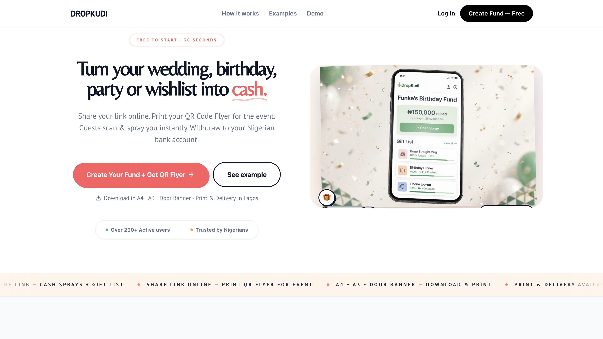
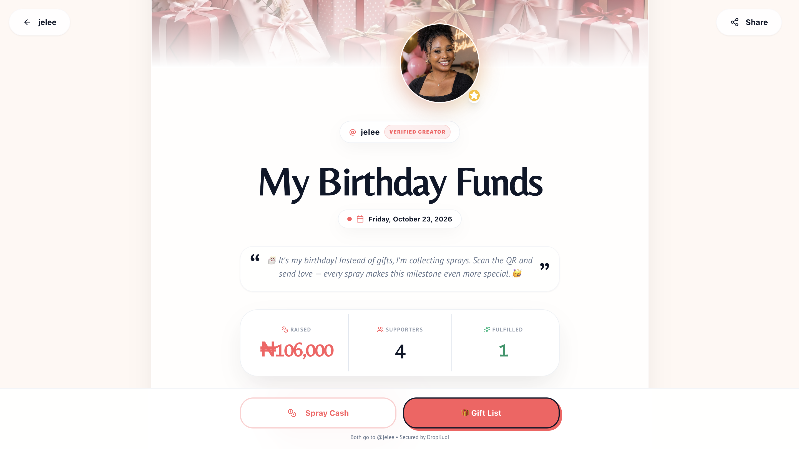
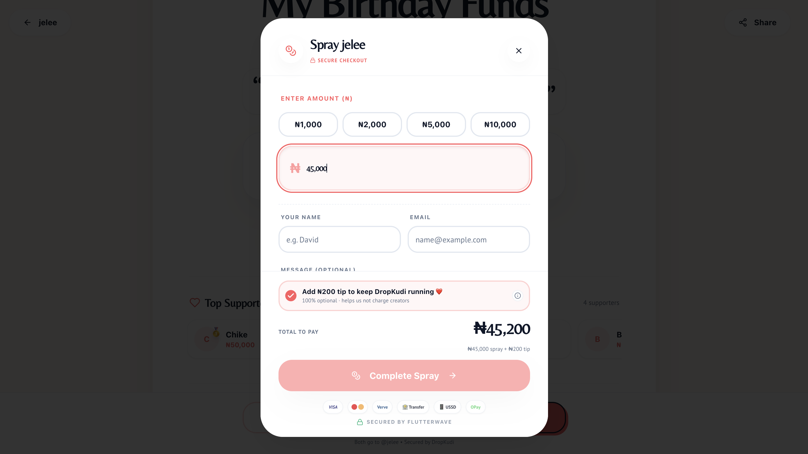
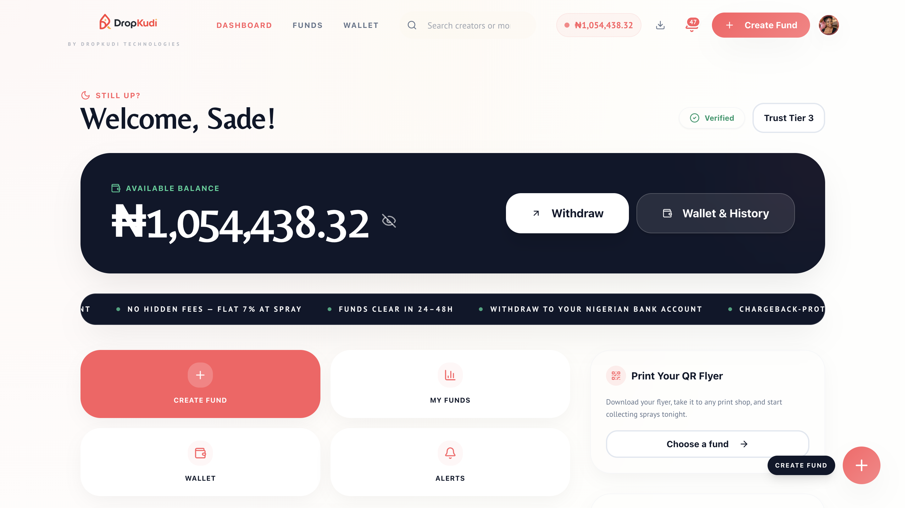
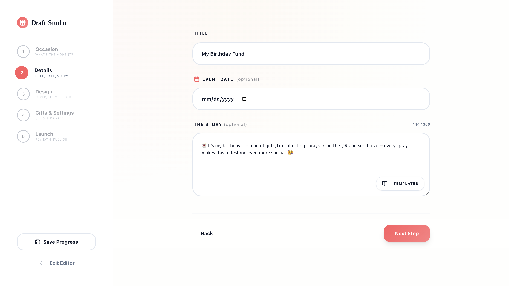
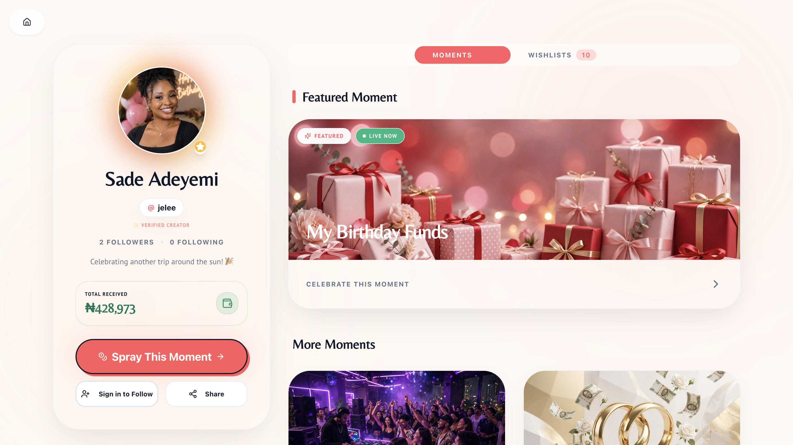
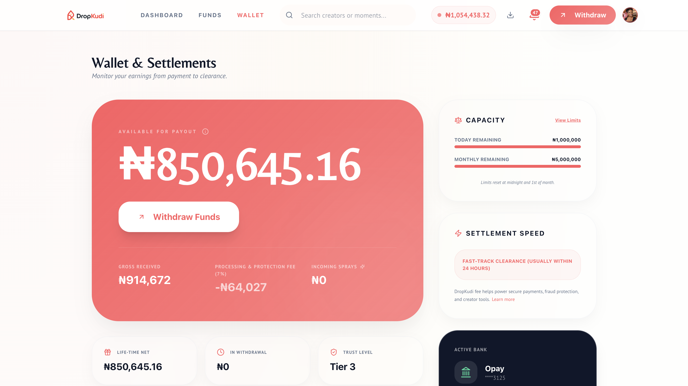

# DropKudi

**Send Gifts. Receive Love.**

[Visit DropKudi](https://dropkudi.com/) · [Developer Portfolio](https://builtbysunny.web.app/)

## Overview

DropKudi is a digital gifting platform designed for birthdays, weddings, celebrations and creator support.

It provides users with a simple way to create and share personal gifting links, allowing friends, family and supporters to send gifts remotely.

The platform brings gifting, payment processing, recipient dashboards and wallet management together in one connected experience.

## Problem

Celebrating important moments often involves coordinating gifts across different locations and payment channels.

For independent creators and individuals, receiving gifts and support from their communities can also be inconvenient.

DropKudi addresses this by providing a dedicated platform where users can create gifting pages, share their links and receive gifts online.

## Core Features

### Personal Gifting Pages

- Create personal gifting pages.
- Share unique gifting links.
- Receive gifts from friends, family and supporters.
- Support gifting for birthdays, weddings and other celebrations.

### Gift Checkout

- Online gift selection and checkout.
- Integrated payment processing.
- Transaction status handling.
- Payment confirmation workflows.

### Dashboard

- User account dashboard.
- Gifting activity and transaction visibility.
- Account and gifting management.

### Draft Studio

- Tools for preparing and managing gifting content.
- Create and organize gifting experiences before publishing.

### User Profiles

- Personal user profiles.
- Account information and profile management.

### Wallet & Withdrawals

- Wallet balance management.
- Transaction history.
- Withdrawal requests.
- Bank payout workflows.
- Withdrawal status tracking.

## Technologies and Integrations

- Next.js
- React
- TypeScript
- Firebase
- Cloud Firestore
- Tailwind CSS
- Paystack
- Flutterwave
- REST APIs

## My Role

**Founder and Full-Stack Product Developer**

I lead product direction and hands-on software development, working across application architecture, frontend development, backend integrations, payment workflows, database operations and platform features.

## Engineering Work

Key areas of development include:

- Full-stack application development.
- Gifting page creation and sharing workflows.
- Payment initiation and verification.
- Payment transaction status management.
- Wallet and withdrawal functionality.
- Firebase and Firestore data management.
- Payment provider integrations.
- User dashboards and profile management.
- Administrative and platform management workflows.

## Payment and Wallet Architecture

DropKudi integrates payment providers to support online gifting transactions and recipient payouts.

The platform also implements wallet management and withdrawal workflows to help users manage funds received through gifting.

Sensitive payment credentials, private transaction records and internal security implementation details are intentionally excluded from this public documentation.

## Technical Challenges and Decisions

This section will document specific engineering challenges, architectural decisions and implementation trade-offs encountered while building and maintaining DropKudi.

Examples will focus on payment verification, transaction consistency, wallet accounting and withdrawal processing without exposing security-sensitive implementation details.

## Screenshots and Demo

### Homepage

### Personal Gifting Page

### Gift Checkout

### User Dashboard

### Draft Studio

### User Profile

### Wallet

## Project Status

**Live product.**

DropKudi is publicly launched and provides working gifting, payment, dashboard, wallet and withdrawal functionality.

## Links

- Product: https://dropkudi.com/
- Developer Portfolio: https://builtbysunny.web.app/
- GitHub: https://github.com/starblackmedia

*This repository documents the product and selected engineering work. Proprietary application source code and sensitive payment implementation details remain private.*