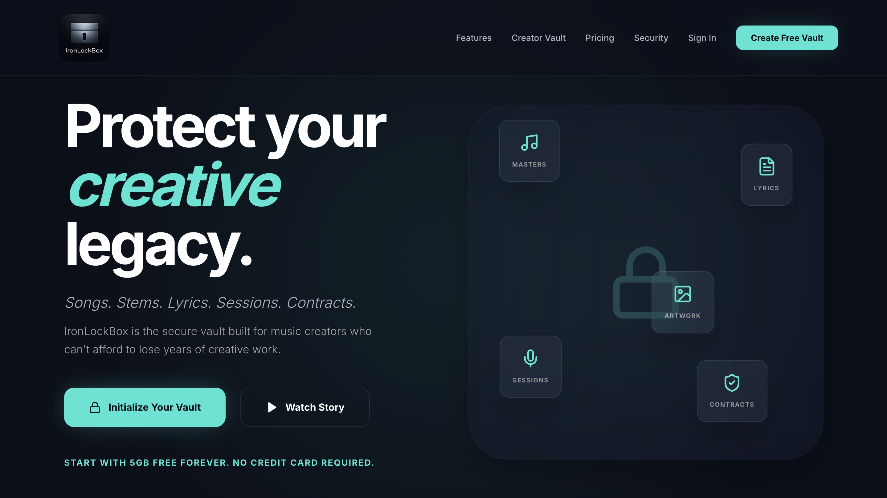
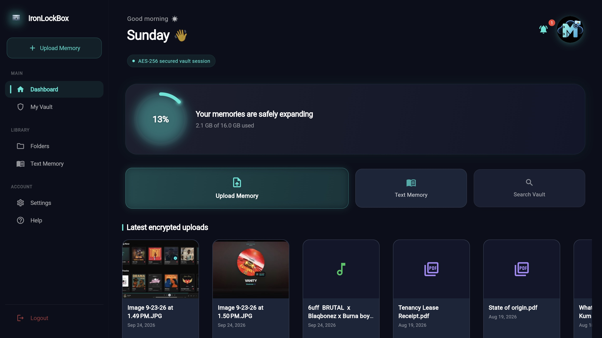
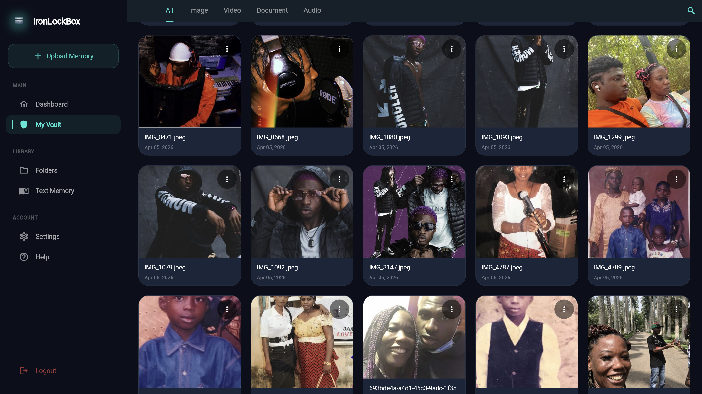
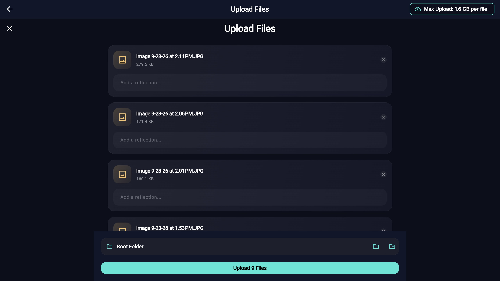
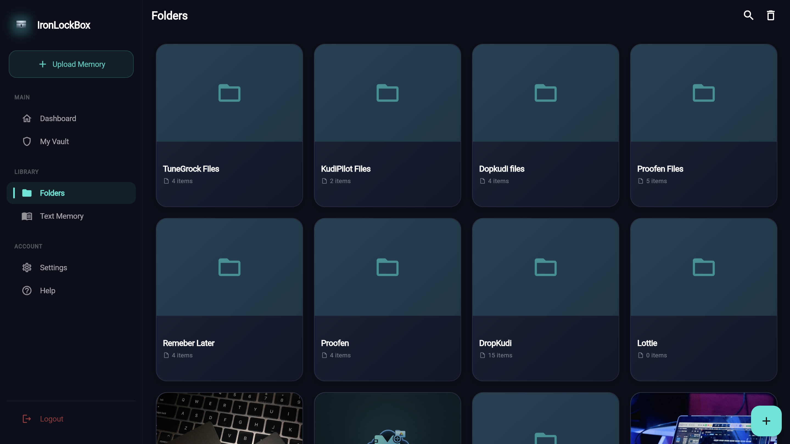
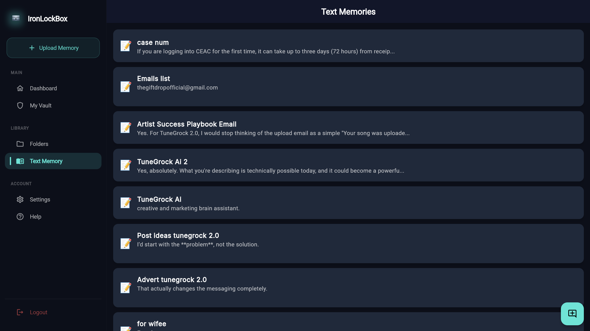
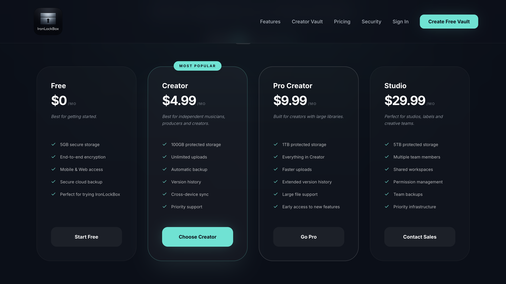

# IronLockBox

**Protect Your Creative Legacy.**

[Visit IronLockBox](https://app.ironlockbox.com/) · [Developer Portfolio](https://builtbysunny.web.app/)

## Overview

IronLockBox is a secure digital vault designed specifically for music creators who need to protect and preserve their creative work.

The platform provides dedicated spaces for storing music masters, stems, lyrics, voice notes, production sessions, artwork, contracts and other important creative assets.

Rather than treating cloud storage as generic file management, IronLockBox focuses on protecting the digital assets behind a creator's career.

The application combines encrypted storage, organized creator vaults, cloud infrastructure and flexible storage plans in one platform.

## The Problem

Music creators often distribute their work across laptops, external drives, phones and different cloud storage services.

A damaged drive, stolen device or accidentally deleted folder can result in years of creative work being lost.

IronLockBox addresses this problem by providing a dedicated digital preservation platform built around the needs of artists, producers, songwriters and other music professionals.

## Core Features

### Creator Vaults

Purpose-built storage spaces for different categories of creative work.

- Music Vault — masters, stems, sessions and instrumentals.
- Idea Vault — lyrics, voice notes, hooks and melody ideas.
- Content Vault — cover artwork, music videos and promotional assets.
- Business Vault — contracts, split sheets and publishing documents.
- Notes Vault — production plans, creative references and rollout ideas.
- Legacy Vault — preservation of important creative assets.

### File and Folder Management

- Upload and organize creative files.
- Create and manage folders.
- Organize assets within dedicated vaults.
- Access stored creative materials through the application.

### Text Memory Preservation

IronLockBox also supports the preservation of text-based creative materials, including lyrics, songwriting ideas, notes and other important written content.

### Security and Privacy

- End-to-end encryption.
- Secure user authentication.
- Protected access to personal vaults.
- Encrypted storage workflows.

### Cloud Infrastructure

- Firebase backend integration.
- Cloud Firestore database.
- Firebase Storage integration.
- Cloud Functions for server-side file processing.

### Storage Plans and Payments

IronLockBox provides flexible storage plans designed for different creator needs.

- Free plan with 5GB storage.
- Creator plan with 100GB storage.
- Pro Creator plan with 1TB storage.
- Studio plan with 5TB storage.

Paystack integration supports payment processing for the platform's paid offerings.

## Technologies and Integrations

- Flutter
- Dart
- Firebase
- Cloud Firestore
- Firebase Authentication
- Firebase Storage
- Firebase Cloud Functions
- Paystack

## My Role

**Product Developer and Application Engineer**

I worked on the product concept and hands-on application development, building the creator-focused vault experience and integrating the services required for authentication, cloud storage, database management, file processing and payments.

## Engineering Work

Key areas of development include:

- Flutter application development.
- Dart application programming.
- Firebase backend integration.
- User authentication and account management.
- Cloud Firestore data management.
- Firebase Storage integration.
- Server-side file processing with Cloud Functions.
- End-to-end encryption implementation.
- Creator vault and folder management.
- File upload and organization workflows.
- Text-based memory preservation.
- Paystack payment integration.
- Storage plan and subscription experiences.

## Technical Architecture

IronLockBox combines a Flutter application with Firebase-powered backend services.

Firebase Authentication handles user identity, Cloud Firestore manages application data, and Firebase Storage provides file storage infrastructure.

Cloud Functions support server-side file processing, while the application's end-to-end encryption approach is designed to protect the privacy of creators' stored content.

The architecture brings together mobile application development, cloud infrastructure, file management and payment integration in a single product.

## Screenshots and Demo

### Homepage

### User Dashboard

### Creator Vaults

### File Upload

### Folder Management

### Text Memory

### Pricing

## Project Status

**Live and functional application.**

IronLockBox is an active product developed under TuneGrock Technologies.

## Links

- Application: https://app.ironlockbox.com/
- Developer Portfolio: https://builtbysunny.web.app/
- GitHub: https://github.com/starblackmedia

*This repository documents the product and selected engineering work. Proprietary application source code, encryption implementation details and sensitive infrastructure configurations remain private.*