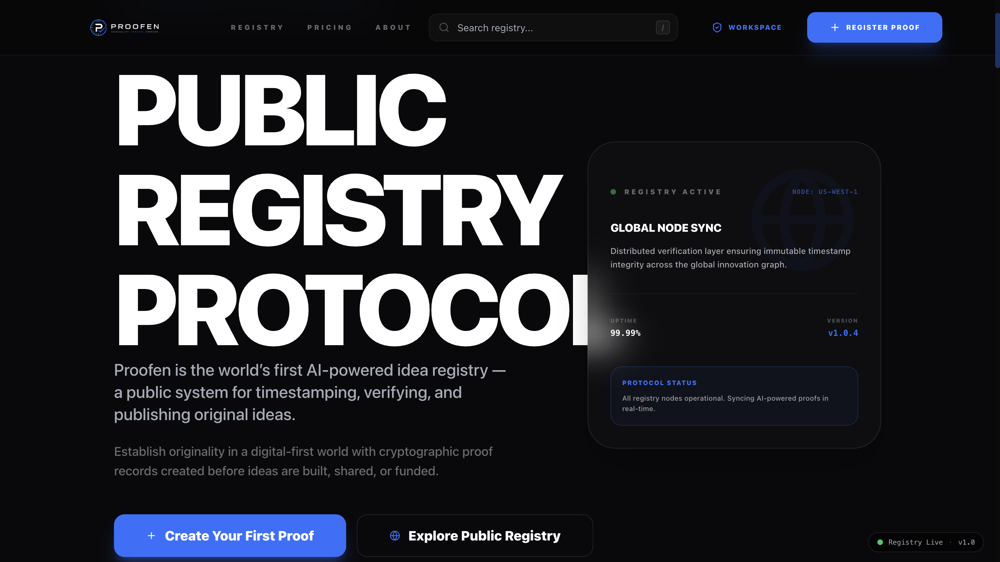
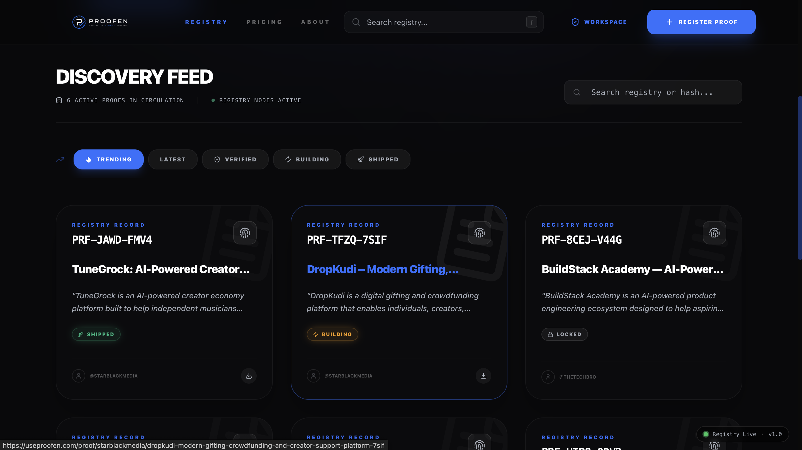
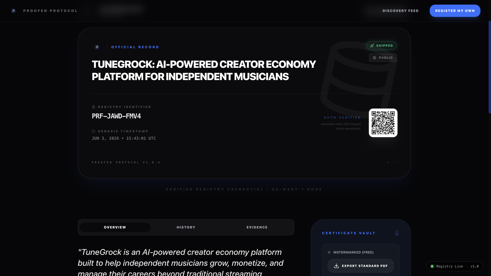
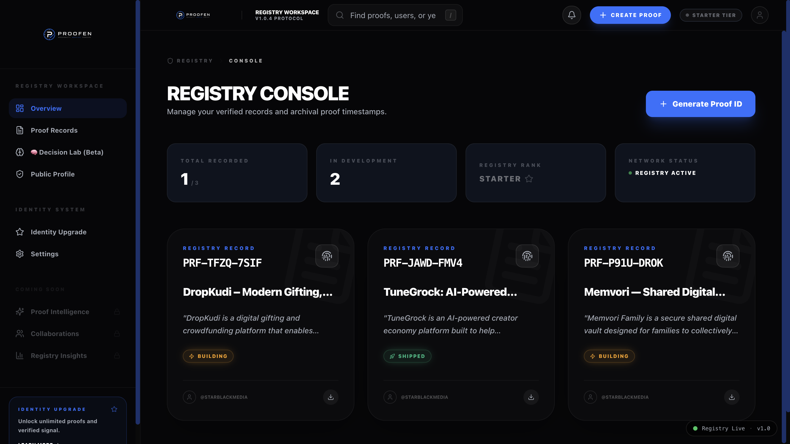
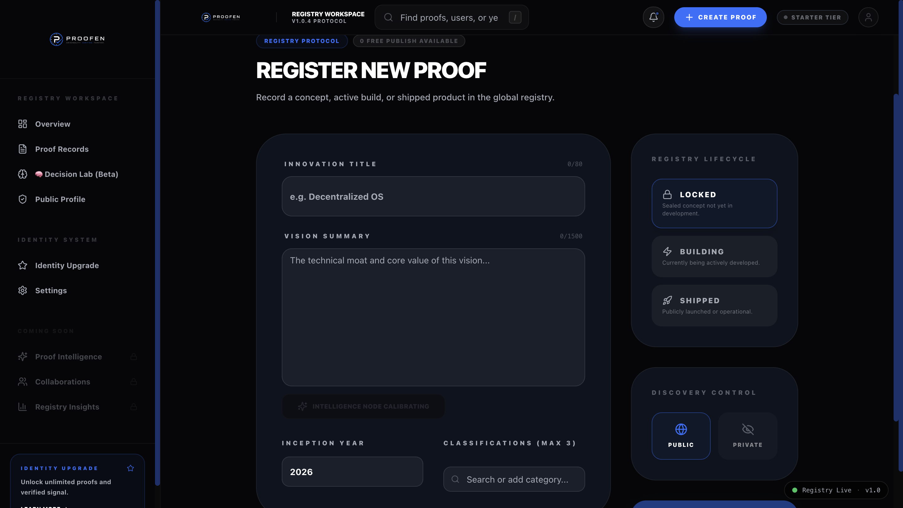

# Proofen

**The Public Registry for Original Human Ideas.**

[Visit Proofen](https://useproofen.com/) · [Developer Portfolio](https://builtbysunny.web.app/)

## Overview

Proofen is an AI-powered idea registry designed to help individuals establish a verifiable record of their original ideas.

The platform allows users to submit ideas, generate unique Proof IDs, and publish structured records to a public registry. Each record provides a reference point for documenting an idea's originality and tracking its journey from initial registration through development.

Proofen combines public idea registration, proof records, search and discovery, and AI-powered intelligence in one platform.

## The Problem

Ideas are often developed, shared, discussed, or presented to potential collaborators and investors without a structured way to establish when they were first documented.

Proofen addresses this challenge by providing a dedicated registry where users can record ideas, generate identifiable proof records, and make those records publicly accessible.

## Core Features

### Idea Registration

- Submit original ideas through a structured registration form.
- Generate unique Proof IDs.
- Create individual records for registered ideas.
- Publish ideas to the public registry.

### Public Idea Registry

- Explore publicly registered ideas.
- Search and discover registry records.
- View individual proof details.
- Access publicly available idea information.

### Proof Lifecycle Tracking

- Track an idea from registration through development.
- Support lifecycle stages such as Registered, Building, and Shipped.
- Document the progression of ideas into real products.

### Proofen Intelligence

Powered by OpenAI GPT, Proofen Intelligence helps users develop and communicate their ideas more effectively.

Its capabilities include:

- Idea structuring.
- Market positioning.
- Investor-readiness summaries.
- Turning raw concepts into clearer, structured proposals.

### User Workspace

- Manage registered ideas.
- Access personal proof records.
- Monitor idea development.
- Manage the user's registry activity.

## Technologies and Integrations

- Next.js
- React
- TypeScript
- Firebase
- Cloud Firestore
- Tailwind CSS
- OpenAI GPT

## My Role

**Founder and Full-Stack Product Developer**

I led the product concept, direction and hands-on development of Proofen, working across the application interface, backend services, database integration, AI functionality and registry experience.

## Engineering Work

Key areas of implementation include:

- Full-stack application development.
- User authentication and account management.
- Idea submission and registration workflows.
- Unique Proof ID generation.
- Public registry and searchable records.
- Individual proof detail pages.
- Firestore data management.
- AI integration using OpenAI GPT.
- Idea lifecycle management.
- User workspace and registry management.

## Technical Challenges and Decisions

Proofen brings together several product concepts that need to work as one experience: idea registration, unique record identification, public discovery, AI-assisted structuring and lifecycle tracking.

The application was designed around structured registry records so users can manage their ideas while making selected records accessible through public pages.

The AI functionality complements the registry rather than replacing its central purpose: documenting and tracking original ideas.

## Screenshots and Demo

### Homepage

### Public Registry

### Individual Proof Record

### User Workspace

### Idea Submission

## Project Status

**Live product — Version 1.0**

Proofen is publicly available at https://useproofen.com/.

## Links

- Product: https://useproofen.com/
- Developer Portfolio: https://builtbysunny.web.app/
- GitHub: https://github.com/starblackmedia

*This repository documents the product and selected engineering work. Proprietary application source code and sensitive implementation details remain private.*